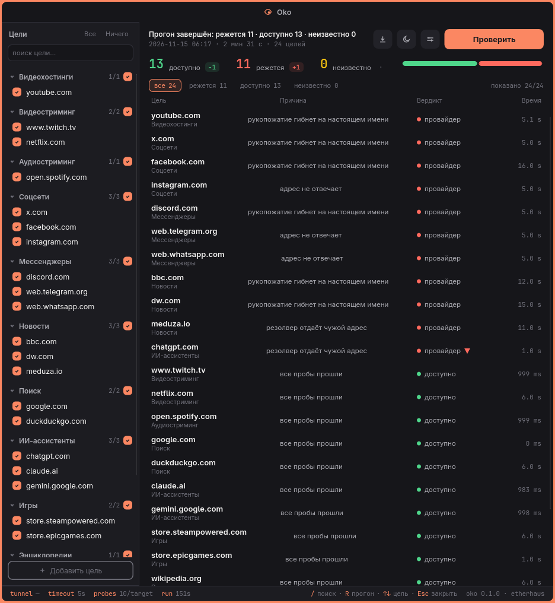
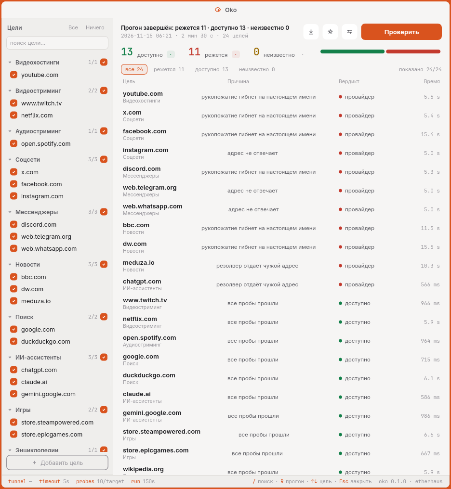

<p align="center">
  
</p>

<h1 align="center">Oko</h1>

<p align="center">
  <a href="README.md">Русский</a> · <b>English</b>
</p>

<p align="center">
  <a href="https://github.com/Etherhaus/oko/releases/latest"></a>
  <a href="https://github.com/Etherhaus/oko/actions/workflows/ci.yml"></a>
  <a href="LICENSE"></a>
  
</p>

<p align="center">
  Oko runs a series of network probes against services people actually use and says what
  stands in the way: a spoofed DNS answer, a middlebox that reads the server name, a blocked
  address, a filtered <code>Host</code> header, a connection cut at 16–20 KB.
  <br>
  <b>It measures, it does not bypass.</b>
</p>

| Dark | Light |
|---|---|
|  |  |

Oko is the companion to [Ether](https://github.com/Etherhaus/ether-ovpn): Ether leads through
the walls, Oko shows where they stand. First see what does not work and why, then decide
whether a tunnel is needed.

## What it measures

| Verdict | What it means |
|---|---|
| `ok` | Every probe reached the service |
| `dns_spoof` | The system resolver's answer is not the one the public DoH references give |
| `dpi_sni` | The handshake with the real name died, and the same address answered a control name |
| `ip_block` | No IPv4 address of the service accepted a connection, while the control target answered |
| `host_filter` | The request with the real `Host` died, and the same address answered a control `Host` |
| `l4_drop` | The body stopped inside the known 16–20 KB or ~25 KB range, with the response still incomplete |
| `geo_block_by_service` | The service is unreachable on both paths — it is refusing this network itself |
| `unknown` | The evidence does not add up to any of the above. Always carries a reason |

Levels follow NetCheck: ok, warning, bad, undetermined. `unknown` is a normal verdict, not a
failure: a tool that calls every silence a block is lying.

## How it does it

A run makes six probes per target, each with its own timeout (5 s by default). The control
target goes first: if it does not answer, the network is ill and nothing can be said about the
services — the run stops honestly. The whole run sits under a watchdog: if something hangs,
the report arrives partial, naming the target it stopped on.

**DNS.** The system resolver against three public DoH references
([RFC 8484](https://www.rfc-editor.org/rfc/rfc8484)): `dns.google`, `cloudflare-dns.com`,
`dns.sb`. Three, not one: a blocked reference must not leave the probe without a baseline.
Addresses are compared, not response times.

**TLS with the real name.** The handshake goes to the service's address with the real SNI
([RFC 6066](https://www.rfc-editor.org/rfc/rfc6066#section-3)). If it fails, the probe repeats
it on the same address with the control name `yandex.ru`, which is known to pass from this
network. If the control answers, the middlebox objects to the name, not to the address. That
is the "white SNI": a control experiment, not a bypass.

**Plain HTTP.** The same for the `Host` header: the real one, then the control one on the same
address. It catches filtering by name in plain HTTP, where there is no SNI at all.

**The body (l4-25).** After the handshake the probe reads up to 64 KB and records where the
stream ended. A cut inside 16–20 KB or around 25 KB is the signature of a known class of
blocking that cuts a connection by a byte counter rather than by name. This is how YouTube has
been throttled in Russia since the summer of 2024; the method and the measurements of that
class are published by [blockcheck](https://github.com/ValdikSS/blockcheck), the discussion
lives in [net4people/bbs](https://github.com/net4people/bbs/issues). A cut counts as a cut only
when the response is incomplete: a server that sent a 17 KB page and closed is doing its job.

**QUIC.** A research probe: a 1200-byte Initial with the grease version `0x1a2a3a4a`
([RFC 9000](https://www.rfc-editor.org/rfc/rfc9000#section-6)). An explicit Version Negotiation
is a fact: UDP reaches the server. Silence proves nothing — a NAT, a provider and the server
itself all produce it. So QUIC never becomes a verdict, only a line in the report.

**The tunnel.** With `--socks5` the same probes run through a proxy and the report compares the
two paths: `blocked on the path` — fails directly, works through the tunnel; `blocked by the
service` — fails on both. The addresses come from the direct run, so a spoofed DNS answer
poisons both paths, and the comparison honestly refuses: `cannot be compared`.

## False positives

A tool that stays quiet about its weak spots is useless. These cases produce `unknown` or a
false alarm, and you should know them in advance.

- **CDNs and geography.** The same service hands out different addresses to different networks.
  An address recorded in the list as a fallback may be stale; comparing against a DoH reference
  that resolves from somewhere else shows a difference with no blocking involved.
- **NAT for UDP.** Silence on QUIC is the most common false argument. That is why QUIC is not
  a verdict.
- **The DoH references.** If the provider cuts DoH itself, the reference goes quiet and
  `dns_spoof` is not raised — the probe says it has no baseline. If one reference is cut, two
  remain.
- **A slow server.** A timeout does not tell a block from congestion. That is what the tunnel
  is for: what is slow on both paths is slow, not blocked.
- **Your own network.** A corporate proxy, a VPN for all traffic, a Pi-hole — each changes the
  resolver's answers and the addresses. Oko measures the network it runs in.
- **A cut at 16–20 KB** also happens when a server simply closed the connection. That is why
  the probe checks the response is complete, by `Content-Length` or the chunked terminator.

## How it differs from OONI and dpi-detector

[OONI Probe](https://ooni.org/install/) is a measurement network: it uploads results to OONI's
servers and builds a public map of blocking from them. Oko sends nothing anywhere and collects
nothing about other people's networks: it answers "what is happening in my network right now".

[dpi-detector](https://github.com/Runn1ng/dpi-detector) looks for a middlebox by trying packet
modifications — fragmentation, TTL changes — that is, it tests what gets through. Oko changes
not a single byte on the wire: it compares a real request with a control one and names the
cause. This is diagnostics, not circumvention, and by construction it cannot become one.

## Check it by hand

The standard of verification is `openssl s_client`. If Oko says `dpi_sni`, here are the same two
handshakes by hand, to the same address:

```bash
# the real name: cut right after "Connecting to …"
openssl s_client -connect 172.217.20.174:443 -servername youtube.com </dev/null

# the control name on the same address: answers with a certificate
openssl s_client -connect 172.217.20.174:443 -servername yandex.ru </dev/null
```

A cut on the first and a certificate on the second is SNI filtering, with no need to trust the
tool. The address comes from Oko's report (`oko probe youtube.com`). On the network where this
README was written the first command prints `Connecting to 172.217.20.174` and goes quiet, and
the second hands back a `*.google.com` chain — exactly what Oko called `dpi_sni`.

## Install

Prebuilt packages are in the [latest release](https://github.com/Etherhaus/oko/releases/latest).
Linux x86_64 and aarch64, four formats for each architecture.

**Debian, Ubuntu, Mint** (`.deb`):

```bash
sudo apt install ./oko_<version>_amd64.deb      # arm64 on ARM
```

**Fedora, openSUSE, RHEL** (`.rpm`):

```bash
sudo dnf install ./oko-<version>-1.x86_64.rpm   # aarch64 on ARM
```

**Arch, CachyOS, Manjaro** (`.pkg.tar.zst`):

```bash
sudo pacman -U oko-<version>-1-x86_64.pkg.tar.zst
```

**Tarball** (`.tar.gz`, needs glibc 2.39+) — exactly what the built-in updater downloads. It
holds the `oko` binary, the icons and the menu entry:

```bash
tar xzf oko-<version>-linux-x86_64.tar.gz
cd oko-<version>-linux-x86_64
install -Dm755 oko ~/.local/bin/oko
install -Dm644 packaging/io.github.etherhaus.Oko.desktop ~/.local/share/applications/
install -Dm644 assets/oko-256.png \
  ~/.local/share/icons/hicolor/256x256/apps/io.github.etherhaus.Oko.png
```

A package installed by a package manager does not update itself: the binary sits in `/usr/bin`,
where self-replacement is refused, and Oko says so plainly. Self-updating works only for the
tarball unpacked into a home directory.

**From source:**

```bash
cargo build --release      # the binary lands in target/release/oko
```

Rust 1.87 or newer. The window is [Slint](https://slint.dev); on Linux the build needs
`libfontconfig1-dev`.

## Verifying a download

Every release archive is signed with [minisign](https://jedisct1.github.io/minisign/), the
signature sits next to it as `.minisig`. The key is built into the binary, and it is the same
key Oko checks its own updates against:

```bash
minisign -Vm oko-<version>-linux-x86_64.tar.gz \
  -P RWRKvw8XRG50X1BykfJ6a/7LOkq5M6av6BNd5yElOMX5SemX8ZNmuM+8
```

If it passes, the file is the one Oko would install on itself. If it does not, do not run it.

## Where Oko goes on the network

The complete list, nothing else:

- **Run targets** — the 24 services in `src/target.rs` (443, 80 or 53, as the probe needs) plus
  three control targets (`yandex.ru`, `vk.com`, `mail.ru`) that the window does not show.
- **DoH references** — `https://dns.google/dns-query`, `https://cloudflare-dns.com/dns-query`,
  `https://dns.sb/dns-query`.
- **The updater** — `https://api.github.com/repos/etherhaus/oko/releases/latest` and a redirect
  to `objects.githubusercontent.com` for the archive and its signature. At most once a day,
  quietly. There is no switch for it in Settings: the daily check can only be pre-empted with
  the Check button, and the request itself can be blocked in your firewall.

There is no telemetry. Not a single request goes out "just because": everything leaves either
on a button press or on the daily update check. The report stays on disk — it carries a
fingerprint of your network, which is why `*.oko.txt` and `*.oko.json` are in `.gitignore`.

## Keyboard

| Keys | Action |
|---|---|
| `/` | Search the targets |
| `R` | Run |
| `↑` / `↓` | Walk the table |
| `Esc` | Close: About → settings → adding → inspector → search |

## Languages

The interface is Russian and English. The first start follows the `LANG` locale, Settings
switches it at any time, and the choice is stored in `~/.config/oko/config.json`. Every string
lives in `src/i18n.rs`, so a new language is one more column in that table. Report text stays
English, as in the CLI and the JSON.

## Security

How Oko updates itself, what it checks before installing, and why it will not replace itself in
a system directory — see [SECURITY.md](SECURITY.md). In short: the minisign signature is checked
**before** the install, nothing unverified is installed under any circumstances, and a binary in
`/usr`, `/opt` or `/bin` is updated by the package manager, not by itself.

## License

Oko is released under the [MIT License](LICENSE). The window is built with
[Slint](https://slint.dev), used under the Slint Royalty-free Desktop, Mobile, and Web
Applications License.
