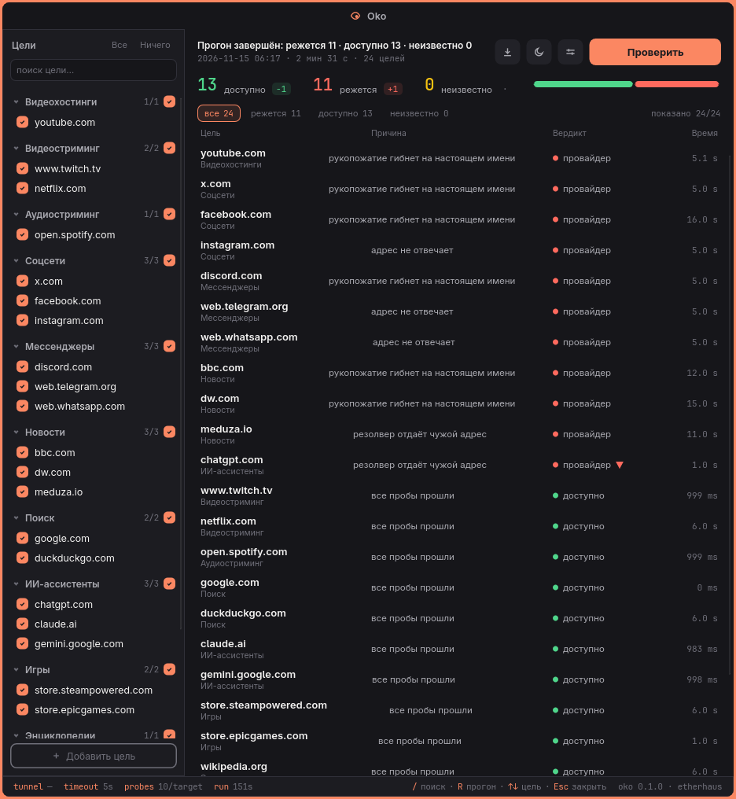
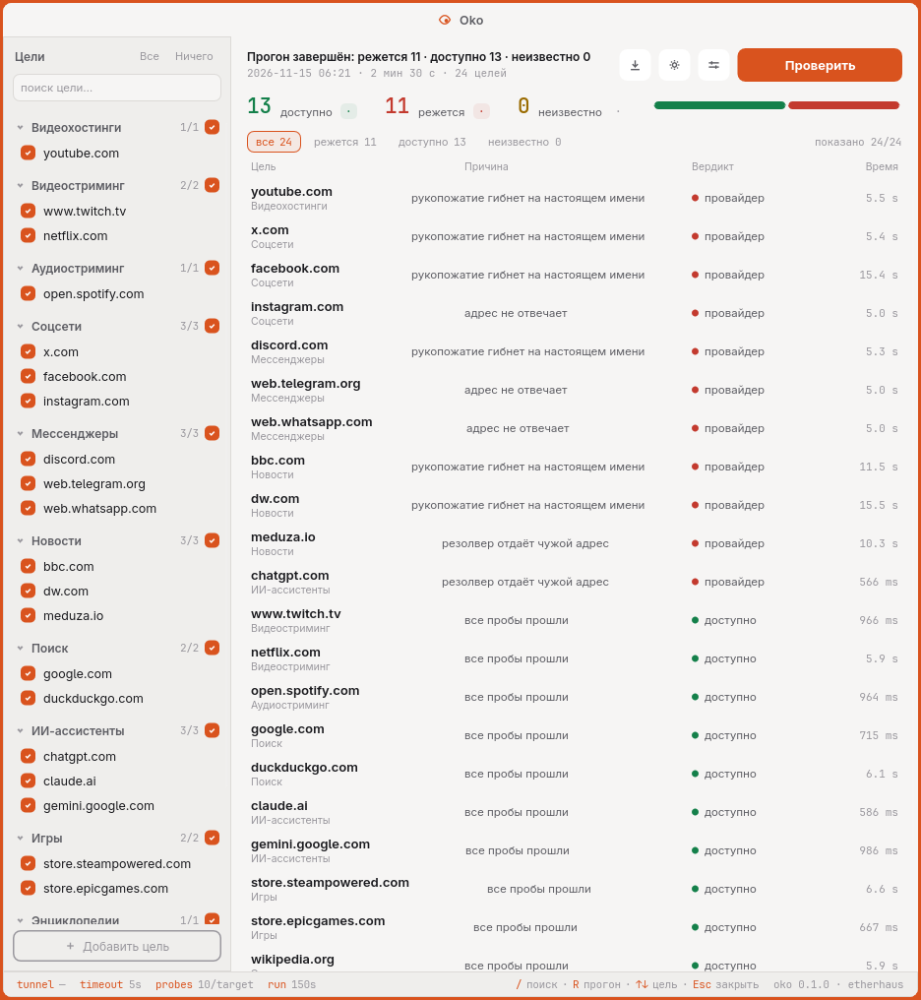

<p align="center">
  
</p>

<h1 align="center">Oko</h1>

<p align="center">
  <b>Русский</b> · <a href="README.en.md">English</a>
</p>

<p align="center">
  <a href="https://github.com/Etherhaus/oko/releases/latest"></a>
  <a href="https://github.com/Etherhaus/oko/actions/workflows/ci.yml"></a>
  <a href="LICENSE"></a>
  
</p>

<p align="center">
  Oko прогоняет серию сетевых проб к сервисам, которыми люди пользуются каждый день,
  и говорит, что именно стоит на пути: подменённый ответ DNS, посредник, читающий имя
  сервера, заблокированный адрес, отфильтрованный заголовок <code>Host</code>,
  соединение, обрезанное на 16–20 КБ.
  <br>
  <b>Измеряет, не обходит.</b>
</p>

| Тёмная | Светлая |
|---|---|
|  |  |

Oko — компаньон [Ether](https://github.com/Etherhaus/ether-ovpn): Ether ведёт сквозь стены,
Oko показывает, где они стоят. Сначала посмотреть, что не работает и почему, потом решать,
нужен ли туннель.

## Что он измеряет

| Вердикт | Что означает |
|---|---|
| `ok` | Все пробы дошли до сервиса |
| `dns_spoof` | Ответ системного резолвера не совпадает с ответом публичных DoH-эталонов |
| `dpi_sni` | Рукопожатие с настоящим именем умерло, а на том же адресе с контрольным именем сервер ответил |
| `ip_block` | Ни один IPv4-адрес сервиса не принял соединение, при этом контрольная цель отвечает |
| `host_filter` | Запрос с настоящим `Host` умер, а на том же адресе с контрольным `Host` сервер ответил |
| `l4_drop` | Тело ответа оборвалось внутри известного диапазона 16–20 КБ или ~25 КБ, ответ при этом неполный |
| `geo_block_by_service` | Сервис недоступен по обоим путям — он сам отказывает этой сети |
| `unknown` | Доказательств не хватает ни на один вывод. Всегда с причиной: что сошлось, что нет |

Уровни — как в NetCheck: ок, предупреждение, плохо, неопределённо. `unknown` — нормальный
вердикт, а не ошибка: инструмент, который на любую тишину отвечает «блокировка», врёт.

## Как он это делает

Прогон идёт по цели шесть проб, каждая — со своим таймаутом (по умолчанию 5 с). Сначала
контрольная цель: если она не отвечает, сеть больна и судить о сервисах нельзя — прогон
честно останавливается. Весь прогон под сторожевым таймбоксом: если что-то зависло,
отчёт придёт частичным, с указанием, на какой цели он прервался.

**DNS.** Системный резолвер против трёх публичных DoH-эталонов
([RFC 8484](https://www.rfc-editor.org/rfc/rfc8484)): `dns.google`, `cloudflare-dns.com`,
`dns.sb`. Три, а не один: заблокированный эталон не должен оставить пробу без базы.
Сравниваются адреса, а не время ответа.

**TLS с настоящим именем.** Рукопожатие идёт на адрес сервиса с настоящим SNI
([RFC 6066](https://www.rfc-editor.org/rfc/rfc6066#section-3)). Если оно не удалось —
повтор на том же адресе с контрольным именем `yandex.ru`, которое с этой сети заведомо
проходит. Ответил контроль — значит, посредник возражает против имени, а не против адреса.
Это и есть «белый SNI»: не обход, а контрольный опыт.

**Открытый HTTP.** То же самое для заголовка `Host`: настоящий, затем контрольный на том же
адресе. Ловит фильтрацию по имени в plain HTTP, где SNI нет вовсе.

**Тело ответа (l4-25).** После рукопожатия проба читает тело до 64 КБ и запоминает, где
поток кончился. Обрыв внутри 16–20 КБ или ~25 КБ — это подпись известного класса блокировок,
при котором соединение режут по счётчику байт, а не по имени. Так в России с лета 2024
замедляют YouTube; методику и замеры этого класса публикует
[blockcheck](https://github.com/ValdikSS/blockcheck), обсуждение — в
[net4people/bbs](https://github.com/net4people/bbs/issues). Обрыв считается обрывом только
при неполном ответе: сервер, который отдал страницу на 17 КБ и закрылся, делает свою работу.

**QUIC.** Исследовательская проба: 1200-байтный Initial с grease-версией `0x1a2a3a4a`
([RFC 9000](https://www.rfc-editor.org/rfc/rfc9000#section-6)). Явный Version Negotiation —
факт: UDP до сервера доходит. Тишина не значит ничего: её даёт и NAT, и провайдер, и сам
сервер. Поэтому QUIC никогда не превращается в вердикт — только в строку отчёта.

**Туннель.** С `--socks5` те же пробы идут через прокси, и отчёт сравнивает два пути:
`blocked on the path` — напрямую не работает, через туннель работает; `blocked by the
service` — не работает ни там, ни там. Адреса берутся из прямого прогона, поэтому
подменённый DNS отравляет оба пути, и сравнение честно отказывается: `cannot be compared`.

## Ложные срабатывания

Инструмент, который молчит о своих слабых местах, бесполезен. Эти случаи дают `unknown`
или ложную тревогу, и о них надо знать заранее.

- **CDN и география.** Один и тот же сервис отдаёт разные адреса разным сетям. Адрес,
  записанный в списке как фолбэк, может быть уже не тот; сравнение с DoH-эталоном,
  который резолвит из другого места, покажет расхождение без всякой блокировки.
- **NAT для UDP.** Молчание QUIC — самый частый ложный довод. Поэтому QUIC и не вердикт.
- **DoH-эталоны.** Если провайдер режет сам DoH, эталон молчит, и `dns_spoof` не
  выставляется — проба скажет, что базы нет. Если режут один эталон, остаются два.
- **Медленный сервер.** Таймаут не отличает блокировку от перегрузки. Для этого и нужен
  туннель: то, что медленно по обоим путям, — медленное, а не заблокированное.
- **Своя сеть.** Корпоративный прокси, VPN на весь трафик, Pi-hole — всё это меняет ответы
  резолвера и адреса. Oko измеряет ту сеть, в которой запущен.
- **Обрыв на 16–20 КБ** бывает и у сервера, который просто закрыл соединение. Поэтому
  проверяется полнота ответа по `Content-Length` или терминатору chunked.

## Чем отличается от OONI и dpi-detector

[OONI Probe](https://ooni.org/install/) — сеть измерений: он шлёт результаты на серверы OONI
и строит из них публичную карту блокировок. Oko ничего никуда не отправляет и не собирает
данные о чужих сетях: он отвечает на вопрос «что происходит в моей сети прямо сейчас».

[dpi-detector](https://github.com/Runn1ng/dpi-detector) ищет посредника перебором
модификаций пакета — фрагментацией, изменением TTL, — то есть проверяет, что помогает
пройти. Oko не меняет ни одного байта на проводе: он сравнивает настоящий запрос с
контрольным и называет причину. Это диагностика, а не обход, и по конструкции не может
стать обходом.

## Проверить руками

Стандарт проверки — `openssl s_client`. Если Oko говорит `dpi_sni`, то вот те же два
рукопожатия вручную, на тот же адрес:

```bash
# настоящее имя: обрывается сразу после «Connecting to …»
openssl s_client -connect 172.217.20.174:443 -servername youtube.com </dev/null

# контрольное имя на том же адресе: сервер отвечает сертификатом
openssl s_client -connect 172.217.20.174:443 -servername yandex.ru </dev/null
```

Обрыв на первом и сертификат на втором — это и есть фильтрация по SNI, без всякой веры
инструменту. Адрес берётся из отчёта Oko (`oko probe youtube.com`). На сети, где писался
этот README, первая команда печатает `Connecting to 172.217.20.174` и замолкает, вторая
отдаёт цепочку `*.google.com` — ровно то, что Oko и назвал `dpi_sni`.

## Установка

Готовые сборки — в [последнем релизе](https://github.com/Etherhaus/oko/releases/latest).
Linux x86_64 и aarch64, по четыре формата на каждую архитектуру.

**Debian, Ubuntu, Mint** (`.deb`):

```bash
sudo apt install ./oko_<версия>_amd64.deb      # arm64 на ARM
```

**Fedora, openSUSE, RHEL** (`.rpm`):

```bash
sudo dnf install ./oko-<версия>-1.x86_64.rpm   # aarch64 на ARM
```

**Arch, CachyOS, Manjaro** (`.pkg.tar.zst`):

```bash
sudo pacman -U oko-<версия>-1-x86_64.pkg.tar.zst
```

**Архив** (`.tar.gz`, glibc 2.39+) — ровно то, что скачивает встроенный апдейтер. Внутри
бинарник `oko`, иконки и файлы для меню:

```bash
tar xzf oko-<версия>-linux-x86_64.tar.gz
cd oko-<версия>-linux-x86_64
install -Dm755 oko ~/.local/bin/oko
install -Dm644 packaging/io.github.etherhaus.Oko.desktop ~/.local/share/applications/
install -Dm644 assets/oko-256.png \
  ~/.local/share/icons/hicolor/256x256/apps/io.github.etherhaus.Oko.png
```

Пакет, поставленный пакетным менеджером, себя не обновляет: бинарник лежит в `/usr/bin`, а
там самозамена запрещена, и Oko честно скажет «обновляй пакетным менеджером». Самообновление
работает только для архива, распакованного в домашний каталог.

**Из исходников:**

```bash
cargo build --release      # бинарник в target/release/oko
```

Нужен Rust 1.87 или новее. Окно — [Slint](https://slint.dev); на Linux для сборки нужен
`libfontconfig1-dev`.

## Проверка загрузки

Каждый архив релиза подписан [minisign](https://jedisct1.github.io/minisign/), подпись
лежит рядом — `.minisig`. Ключ вшит в бинарник, и по нему же Oko проверяет свои обновления:

```bash
minisign -Vm oko-<версия>-linux-x86_64.tar.gz \
  -P RWRKvw8XRG50X1BykfJ6a/7LOkq5M6av6BNd5yElOMX5SemX8ZNmuM+8
```

Прошла проверка — файл тот же, который Oko поставил бы себе сам. Не прошла — не запускайте.

## Куда Oko ходит по сети

Полный список, больше ничего:

- **Цели прогона** — 24 сервиса из `src/target.rs` (443, 80 или 53 — по нужде пробы) плюс
  три контрольные цели (`yandex.ru`, `vk.com`, `mail.ru`), которых в окне не видно.
- **DoH-эталоны** — `https://dns.google/dns-query`, `https://cloudflare-dns.com/dns-query`,
  `https://dns.sb/dns-query`.
- **Апдейтер** — `https://api.github.com/repos/etherhaus/oko/releases/latest` и редирект на
  `objects.githubusercontent.com` за архивом и его подписью. Не чаще раза в сутки, тихо.
  Выключателя в настройках нет: автопроверку можно только перебить ручной кнопкой
  «Проверить», а сам запрос — закрыть файрволом.

Телеметрии нет. Ни одного запроса «просто так»: всё уходит либо по нажатию кнопки, либо
по суточной автопроверке обновлений. Отчёт остаётся на диске — он содержит отпечаток вашей
сети, поэтому `*.oko.txt` и `*.oko.json` внесены в `.gitignore`.

## Клавиатура

| Клавиши | Действие |
|---|---|
| `/` | Поиск по целям |
| `R` | Прогон |
| `↑` / `↓` | Ход по таблице |
| `Esc` | Закрыть: «О программе» → настройки → добавление → инспектор → поиск |

## Языки

Интерфейс — русский и английский. Первый запуск следует локали `LANG`, переключается
в настройках; выбор хранится в `~/.config/oko/config.json`. Все строки лежат в
`src/i18n.rs`, так что новый язык — это ещё одна колонка в таблице. Текст отчётов
остаётся английским, как в CLI и JSON.

## Безопасность

Как Oko обновляется, что он проверяет до установки и почему не ставит себя в системные
каталоги — в [SECURITY.md](SECURITY.md). Коротко: подпись minisign проверяется **до**
установки, непроверенное не ставится ни при каких условиях, а бинарник из `/usr`, `/opt`
или `/bin` обновляется пакетным менеджером, а не сам собой.

## Лицензия

Oko распространяется по [лицензии MIT](LICENSE). Окно собрано на
[Slint](https://slint.dev), используется по Slint Royalty-free Desktop, Mobile, and Web
Applications License.
